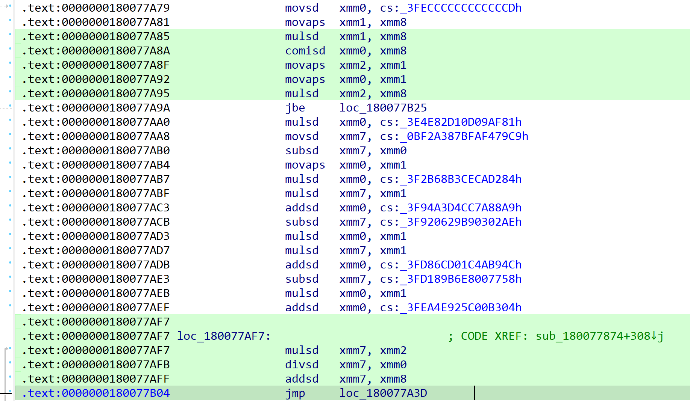

# 在Chrome 148及以上利用tanh函数探测操作系统

# ECMAScript实现


https://dev\.com\.cn/posts/chromium\-148\-math\-tanh\-7lmf

近期的一篇文章表明Chrome 148近期的改动让Math\.tanh的计算结果在各个操作系统上均得到不同的结果，例如Math\.tanh\(0\.8\)在Windows上的计算结果的尾数末位是489，Linux与Mac则是8491与849，而此前tanh的计算结果是与平台无关且统一的，这意味着在Chrome 148及以上版本，**可以通过tanh的计算结果探测用户的真实操作系统**，识别伪造的UA，并作为浏览器指纹之一。**但文章没有详细说明原理，我们接下来分析chromium内核。**


为了实现ECMAScript规范规定的各种内置行为/对象，V8开发者会基于CodeStubAssembler生成框架手写大部分标准库实现（CSA本质上是一种与平台相关的IR，内置了大量指令宏适配各个架构，它基本只比机器指令高出半层抽象，因此手写CSA与手写汇编几乎没有区别，甚至要手动管理寄存器和堆栈帧），在编译时由TurboFan后端直接转化为机器代码以优化执行效率。为了增强可维护性，v8\.dev在2018年宣布引入Torque以实现ECMAScript规范中的大部分标准库，因此后续的大部分分析均与Torque/CSA相关。


在V8实现中，Math\.tanh以及其它数学函数的逻辑不直接由引擎编写，而是定义在math\.tq文件的MathTanh函数中，该函数内部调用的接口Float64Tanh被extern macro修饰，表明其实际运算细节最终仍由C代码或CSA负责。构建过程中，Torque编译器会解析math\.tq文件，并直接转译为包含CSA IR的中间产物math\-tq\-csa\.cc，MathTanh在产物内拥有对应的CSA IR流方法体，接着，代码通过TF\_BUILTIN宏生成对应的内置节点Builtin::kMathTanh，最终bootstrapper\.cc在V8引擎初始化时，该Builtin节点以及CSA方法指针被挂载至JS的Math\.tanh标准接口上。因此，在JS环境内执行Math\.tanh后，V8会调用MathTanh CSA生成的机器指令，并最终进入Float64Tanh接口。


Float64Tanh接口没有单独的内置实现，相反，它实际上也不算“接口”，如果你观察math\.tq生成的CSA产物，会发现它是由TurboFan定义的机器级操作码，类比Ignition的字节码，V8会在解释器的bytecodes\.h内为V8字节码注册节点并声明具体的CSA实现，同样的，TurboFan在compiler/opcodes\.h中将Float64Tanh注册为操作码节点，并在machine\-operator\-reducer\.cc这个Pass内将Float64Tanh节点折叠为指向base::ieee754::tanh函数的调用（这里仅讨论输入参数为编译期常数的情况，其它情况可能进入指令选择器，但执行结果是一致的），在最新的代码仓库中，base::ieee754::tanh指向std::tanh，这意味着tanh的计算实际上取决于编译后依赖的平台标准库，不同操作系统对tanh的实现不同导致计算结果出现差异，因此可以利用这一点对操作系统进行探测。


而在2026年3月份之前，从ieee754\.cc的代码可见tanh的实现依旧为Chromium内核自行实现（或者说为fdlibm的移植版本），因此在Chrome 148之前，tanh的计算结果不会受到平台影响，直至commit c148629之后，谷歌移除了自定义实现并将计算过程委托给标准库。

# 标准实现差异





在Windows上，Clang会将std::tanh动态链接到ucrtbase\.dll内tanh函数的标准实现，ucrt会根据x86硬件支持FMA3指令集与否选择性进入由FMA3支持或传统SSE指令集支持的tanh计算。当计算tanh\(0\.8\)时，会进入如上分支，左侧为SSE实现，右侧为FMA3实现，对比指令操作的常数可知二者在实现上本质相同，区别仅仅是指令优化导致的执行效率不同，为了方便理解，我们选取SSE实现进行分析。


ucrt对tanh的计算采用基于Remez算法的极小极大有理逼近，具体表现为tanh\(x\) ≈ x \+ x³ \* P\(x²\) / Q\(x²\)的有理分式，运行时，ucrt直接将x²代入一组硬编码在dll中的多项式系数进行乘加运算，整个过程不涉及任何指数函数、循环或迭代。


在Linux平台上，std::tanh动态链接到glibc实现sysdeps/ieee754/dbl\-64/s\_tanh\.c内，可见其实现并非有理数逼近，当计算tanh\(0\.8\)时采用公式tanh\(x\) = 1 \- 2/\(expm1\(2x\) \+ 2\)，可见其实现完全依赖expm1函数的精度，由于expm1内部有多步舍入，由于每一次浮点运算都会引入舍入误差，最终导致结果与ucrt的纯乘加路径产 2 ULP的偏差。

```YAML
[UCRT 有理逼近]
  [UCRT] v7 (|x|)          : 0.8000000000000000 | Hex: 0x3FE999999999999A
  [UCRT] v18 (x²)          : 0.6400000000000001 | Hex: 0x3FE47AE147AE147C
  [UCRT] v19 (分子多项式)  : -0.2853774142224533 | Hex: 0xBFD2439FA1468F12
  [UCRT] v20 (分母多项式)  : 1.0746525834208311 | Hex: 0x3FF131C6E845AB8C
  [UCRT] v7³               : 0.5120000000000001 | Hex: 0x3FE0624DD2F1A9FD
  [UCRT] v19*v7³/v20       : -0.1359632297321511 | Hex: 0xBFC1673E3C943D67

[libm expm1 公式]
  [libm] v5 (|x|)          : 0.8000000000000000 | Hex: 0x3FE999999999999A
  [libm] arg (-2x)         : -1.6000000000000001 | Hex: 0xBFF999999999999A
  [libm] v7 (expm1(-2x))   : -0.7981034820053446 | Hex: 0xBFE98A1050412C7B
  [libm] -v7               : 0.7981034820053446 | Hex: 0x3FE98A1050412C7B
  [libm] v7+2.0            : 1.2018965179946552 | Hex: 0x3FF33AF7D7DF69C2
  [libm] -v7/(v7+2.0)      : 0.6640367702678491 | Hex: 0x3FE53FCA0A748A42

=== 最终结果对比 ===
Windows UCRT 模拟值 : 0.6640367702678489 | Hex: 0x3FE53FCA0A748A40
Linux libm   模拟值 : 0.6640367702678491 | Hex: 0x3FE53FCA0A748A42
底层 IEEE 754 差值 : 2 ULP
```

不同操作系统的数学库会由于CPU架构，硬件特性以及稳定性采取不同的系数表或计算方案，同时IEEE 754标准没有要求tanh计算必须正确舍入，因此各个操作系统的tanh计算可能相互之间会有误差。


