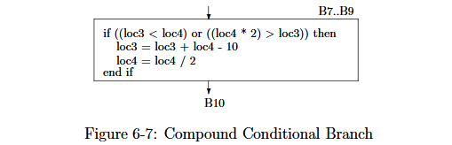

# 反编译原理

# Resources

- Decompiler 技术综述 NDSS 2022 https://rev\.fish/files/bar2022\_keynote\.pdf

- Dr\. Cristina Cifuentes（现代反编译器研究先驱）

    - 现代反编译器理论 https://rgaucher\.info/pub/decompilation\_thesis\.pdf

    - 模式匹配 \+ 控制流恢复 https://www\.cs\.tufts\.edu/\~nr/cs257/archive/cristina\-cifuentes/structuring\-algorithm\.pdf

    - 控制流结构化（与反编译器理论的6\.2节几乎一致） https://link\.springer\.com/chapter/10\.1007/3\-540\-61053\-7\_55

    - DCC 实现 https://web\.archive\.org/web/20130407233420/http://itee\.uq\.edu\.au/\~cristina/dcc\.html

    - DCC 理论 http://profs\.scienze\.univr\.it/\~giaco/download/Watermarking\-Obfuscation/cifuentes95decompilation\.pdf

- No More Gotos https://net\.cs\.uni\-bonn\.de/fileadmin/ag/martini/Staff/yakdan/dream\_ndss2015\.pdf

    - Gotoless Structing，将CFG切分为多个或嵌套的Region，基于语义将Region恢复控制流

- 编译原理

    - CS412 https://www\.cs\.cornell\.edu/courses/cs412/2007sp/schedule\.html

    - 数据流分析框架 https://www\.cs\.cornell\.edu/courses/cs412/2007sp/lectures/lec28\.pdf

# A Structing Algorithm for Decompilation（1993）

## 结构化理论与实现

论文在前序工作中表示当前的结构化算法无法适配反编译工作，因为程序控制流通常是非结构化的，并且高级语言编译出的控制流结构是更加复杂的，因此论文的工作需要处理这种特性。论文指出适用于反编译器的结构化算法应该解决几个问题：

1. 处理循环结构，if\.\.then\.\.else以及case语句

2. 区分不同的循环结构，例如for是一种特殊的while循环

3. 多出口循环只有一个真出口，其它出口应该使用goto

4. 多入口循环更加难以处理，通常不可约

5. 不滥用goto，只有图无法结构化时使用

6. 需要确保功能与结构等价，因此不允许引入新变量，也不允许代码复制

其中问题3\~6在后来被NoMoreGoto论文解决，做到彻底无goto，论文指出算法仅关注可约图，因为任何不可约图都可以通过node spliting转化为可约图。

论文提及了结构化方法中需要用到的3个方法和基础概念，首先，规定有向图G为元组\(V,E,h\)，V为节点集，E为边集，h为有向图的根节点。区间（interval）I\(h\)是一个单入口的子图，h是区间的唯一入口，大图G可以被切分为多个唯一且互不相交的区间\{I\(h1\),I\(h2\)\.\.\.I\(hn\)\}，Fig1内的伪代码描述了针对入口为h的流图，求解区间集合的算法，算法从入口遍历所有节点，建立区间I\(n\)时，算法只将节点的全部直接前驱均属于I\(n\)的节点纳入区间，确保区间内节点从入口处可达，当穷尽当前区间后，算法会挑选下一个候选入口，同时要求入口的至少一个直接前驱属于I\(n\)，确保连通的同时建立新区间。

Fig2描述了派生序列算法，用来从大图G中派生出多个嵌套或者并行的多阶子图G1\.\.\.Gn，一阶图G1通常为大图G，G2则是将G1的所有区间折叠为单个节点得到，算法首先定义了大I为区间集的集合，那么集合内有I1为G1的区间集，I2为G2的区间集\.\.\.，假设算法开始处理二阶图G2，G2由折叠G1的每个区间为单独节点得到，接着算法开始寻找G2内每个二阶节点的直接前驱，规定二阶节点n的直接前驱必须为其内部原头节点h的直接前驱，同时该直接前驱不允许出现在上一阶的对应节点区间中（确保前驱不出现在二阶节点内部），这意味着算法想要限定多阶图内节点的入边必须是其它节点，接着算法开始在二阶节点间生成边\(a,b\)，同时该边的源节点又被限定在上一阶对应区间的任意节点内，目标节点必须为上一阶对应的头节点，说明算法希望当前阶节点间的出边至少要指向上一阶区间的头部，在多阶图的节点以及边生成完毕后，算法开始迭代下一阶的图，直至最终无法再生成为止（下一阶的图与当前阶的图一致）。

Fig3描述了有关图的DFS算法，算法会优先从图内仍有未访问边的节点开始遍历，最终为流图G生成有向、有根、有序的深度优先生成树T（DFST）。生成树内可将原图G的所有边划分为三类：

- 回边 = \{\(v,w\): w\-\>v∈T\}。即w在生成树T内是v的父节点

- 前向边 = \{\(v,w\): v\-\>w∈T\}。即v在生成树T内是w的父节点

- 交叉边 = \{\(v,w\): $\not\exists$\(v\-\>w or w\-\>v\) and w \<= v in preorder\}。w先序遍历编号小于v的情况下，v与w相互不是父节点关系

由于DFS算法处理流图G时生成的树自带偏序关系，这使得并非所有节点都可以相互比较（例如互相不是父节点，无法比较先后），因此论文提出了逆后序，每个节点在最后一次被访问时都会赋予分配编号，编号从节点总数开始递减直至1，这样算法可以根据编号快速判断节点间的回边，以及其它标准边。

论文认为结构化的循环是一个具有指向循环头部节点回边的强连通图，称回边起点为锁存节点（latching node），Fig4定义了三种标准循环，while循环的头节点为判断条件，锁存节点无条件跳回头节点；repeat循环先执行循环体，末尾条件判断决定是否跳回头节点；loop循环的锁存节点无条件跳回循环头。

Fig5描述了数种非规范循环，这些循环在标准循环的基础上多了额外特征。多入口循环与多出口循环如字面意义，有不止一个出入口；相切循环代表同一个强连通图内有多个循环，分为两类：并行循环具有共同头节点；交织循环是两个不同的强连通图，只不过其中一个连通图的头节点是另一个图的锁存节点。

论文还提及，寻找循环的方法基于区间理论以及派生序列算法，区间寻找循环，派生序列确定嵌套层级，论文的目标是在区间内寻找符合标准循环的结构，多余出口被处理为lable\+goto的形式。

假如有区间I\(hj\)，hj是一个循环的头节点，有一个锁存节点nk∈I\(hj\)回到hj，在节点都使用逆后序编号的时候，这种循环特征很好检查，比如锁存节点将是头节点的前驱，并且该节点的编号大于头节点编号，假如有这样的回边，那么只要对着以hj为根的子图按逆序编号遍历一遍就能把循环提取出来。Fig6描述了一个算法，给定循环回边\(a,h\)，算法将返回属于该循环的节点列表。

Fig7描述了一个循环构造算法，对多阶派生图逐阶逐个节点地通过回边寻找循环（取出当前节点的直接前驱之一，并且该前驱的逆后序编号大于当前节点，同时形成的回边需要归属于当前区间），不过如果有循环想将已经被标记为其它循环内部的节点纳入当前循环，那么此循环就不该成立，并且将此节点标记label以供goto使用（我的理解是这破坏了标准循环的特征，成为交织循环）。

论文算法会处理非标准循环，对于只有单个头节点的并行循环，可以把回到头节点的多个回边看作与源码对应的continue语句，由于编译前的源码理论上只有一个循环图，许多回边基本都是编译时由于优化单独抽离出的锁存节点，因此把具有多个回边的并行循环看作同一个循环是合适的，这也符合直觉。对于交织循环，算法会把最内层的循环作为while循环，第二层嵌套循环则使用goto\+label进行处理，第三层重新作为while循环处理\.\.\.以此类推，Fig7的算法本身也会造成这样的布局。

多出口循环通常包含在某个区间内，例如所有出口均指向同一个节点，那么该循环一定包含在某个区间内，若有不同的出口，则选择其中一个出口节点为真出口，其余均为异常出口，异常出口取决于DFST。例如Fig8描述了一个异常的重叠循环图，一种视角是将Fig8看作多入口循环，其带有来自另一个循环锁存节点的入边，另一种视角是将其看作多出口循环，其出边是另一循环的回边，论文则将其判定为后者。

多入口循环通常有n个入口，这些入口属于n个不同的区间，但总是有一个全局循环头并且总有一个区间持有回到该循环头的回边（以Fig10为例）。根据该多入口循环图DFST上各个入边的类型可以区分两种情况：入边为后退边（Backward edge）会产生重叠循环；入边是树边、交叉边或者前向边，这些情况会导致不可约图，由于论文只处理可约图，因此这类情况不会发生。

# Reverse Compilation Techniques（1994）

## 流程概述

这是Dr\. Cristina Cifuentes的博士毕业论文，全文篇幅非常长，与dcc反编译器的实现强相关，论文的1\.3节介绍了反编译器的全部阶段。

首先是语法分析，反编译器需要有解析器以及语法分析器将指令转化为源语言语法的能力，论文以指令sub cx, 50作为例子，该指令在语义上等价于cx = cx \- 50，那么就可以得到Fig1\-11的语法解析树（由cx = \<exp\>以及cx \- 50两层结构形成）。论文还指出语法分析器遇到的主要问题就是区别指令与数据，例如case表可能混在代码段中（dalvik字节码也有这样的情况），不能总是假设下一个字节总是指令，而是启发式地解析指令。

下一阶段是语义分析，这一段论文特别提到了识别machine idiom并还原的情况（窥孔优化也是idiom的一种，详细可见编译原理），在二进制反编译中，反编译器的另一个难点就是识别这些idiom并还原精确语义（我的理解是需要反编译器内置大量反窥孔优化规则），还用Fig1\-4举了两个编译器优化等效指令的例子，例如将位操作指令识别为源程序中等效的乘法操作，以及从两条独立的指令识别出源程序中对长整型变量进行操作的语义，并做正确的类型传播。

通用反编译器可以为后端定义一套自己的中间表示（IR），该中间表示独立于目标语言以及原始机器码，Fig4\-29展示了自定义IR在通用反编译流程中起到的作用：反编译器将不同架构的机器指令或者不同框架的字节码设法提升为自定义IR，这种IR通常被设计得利于反编译器进行分析，例如控制流生成或者数据流分析，分析结束后反编译器再将IR转化为高级语言。自定义IR在不同架构的反编译任务间可复用，而不是将多种架构的机器码与目标语言一对一进行转换，从而降低分析成本。

控制流生成阶段就不必多说了，反编译器主要的任务是识别影响控制流的指令与操作并还原流图，得到流图后的结构化阶段在上面的论文解读中已经详细说过。数据流分析阶段，论文提出反编译器需要分析栈的使用与变化，将大量指令的“中间状态”消除，输出类似高级表达式的形式，比如上图的例子将多个asgn指令折叠为单个类高级表达式形式，也不难看出这项工作与在后序被正式提出的SSA比较类似，通过def\-use做常量传播，跟踪变量，对一些中间操作进行折叠，消除死代码等等。

最终在代码生成阶段，反编译器根据对栈布局，参数，寄存器变量，以及对控制流分析的结果生成高级语言。

## 控制流分析

一个由反编译流水线前端生成的简单控制流图不包含任何高级语言控制结构（例如if\.\.\.else，do\.\.\.while等等结构），但可以通过结构化算法将其转化为具备高级语言结构的“结构化图”，例如算法会在图内识别出某些特定的高级控制结构，并对控制结构对应的子图打标。总之，虽然论文没有明说这一点，但结构化图基本上就是对原控制流图的部分可识别结构附加额外元数据，方便反编译器后端在代码生成阶段即时处理，而非将原图重组、销毁、或处理为某种全新的表现形式。

Fig6\-2是一个未结构化的控制流图，论文随即借此图举了几个例子来描述结构化过程。

### 结构化循环

首先算法尝试从图中识别出循环结构，循环通常通过回边来检测，例如从图内较低位置的节点回到高位节点，如\(B14,B13\)与\(B15,B6\)。循环的类型通过检查循环的头节点与最后一个节点来检测，例如\(B14,B13\)的头节点无条件判断，但尾节点通过条件判断是否开启循环，显然是一个do\.\.\.while类型的后测试循环，表示该循环结构的子图可以被折叠为Fig6\-3中描绘的节点，节点保存了所有这类结构所需的中间指令以及循环类型（以便后端直接处理）。

相反的，\(B15,B6\)的头节点通过一个条件判断决定是否启动循环，尾节点作为锁存节点则直接回到头节点，这个循环结构显然是while类型的前测试循环，因此此循环结构在逻辑上可以被替换为Fig6\-4的子图，该子图同样可以被折叠为包含循环所需数据的节点。

### 结构化条件

B2是典型的两路条件分支结构，当条件为真则B2节点进入B4，否则进入B3，这两个节点又均进入同一个节点B5，也就是说条件分支始于B2结于B5，该图显然是if\.\.\.else结构，可以被转化为Fig6\-5的子图，该子图代表B2、B3、B4几个基本块折叠而成的节点。

B1也是一个两路条件节点，当B1的条件loc3 \>= loc4为真时进入B5节点，否则进入B2节点，之前的例子中，B2、B3与B4已经被合并为单个结构化后的节点，其出边为B5，因此B5就可以通过B1的其中一个条件分支直达，也可以在另一个分支内通过一个合并节点间接到达，这个B1的两路分支显然是if单分支结构，因此该子图可以与B2\~B4合并节点再次合并为Fig6\-6表示的节点。其中B1处条件为了方便与另一个合并节点进行合并已进行取反，使得该条件的假分支构成if一部分的单分支（B5无论条件真假最终都要执行）。

B7与B8显然是两个两路条件节点，但无法直接用if\.\.\.then和if\.\.\.else结构来结构化此图，因为如果把B8视为if\.\.\.else结构的头节点，B10为尾节点，那么B7就是if\.\.\.then的头，那么B7就无法直接进入B8为头的被结构化的子图，而是通过条件分支的一个子句进入，这显然导致语义丢失。如果先把B7结构化为if\.\.\.then，就会因为B8能绕开B9直接到达B10而破坏了if\.\.\.then结构，因此此图无法直接结构化。

但由于B7与B8均只有条件跳转指令，因此可以把两个条件合并为复合条件节点：$(loc3<loc4) \;\lor\; \big(\; \neg(loc3<loc4) \land \neg\big((loc4*2)\le loc3\big)\;\big)$也就是化简后$(loc3<loc4) \;\lor\; \big((loc4*2) > loc3\big)$时进入B9，否则进入B10，意味着B7与B8条件复合后可以转化为尾节点为B10的if\.\.\.then结构，例如转换后的Fig6\-7子图。

